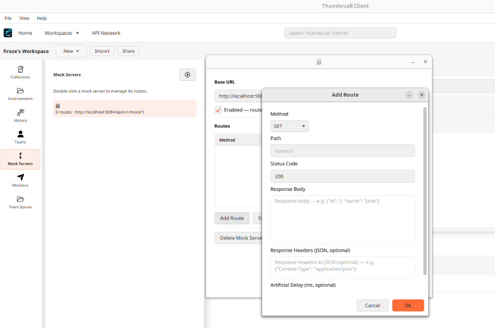
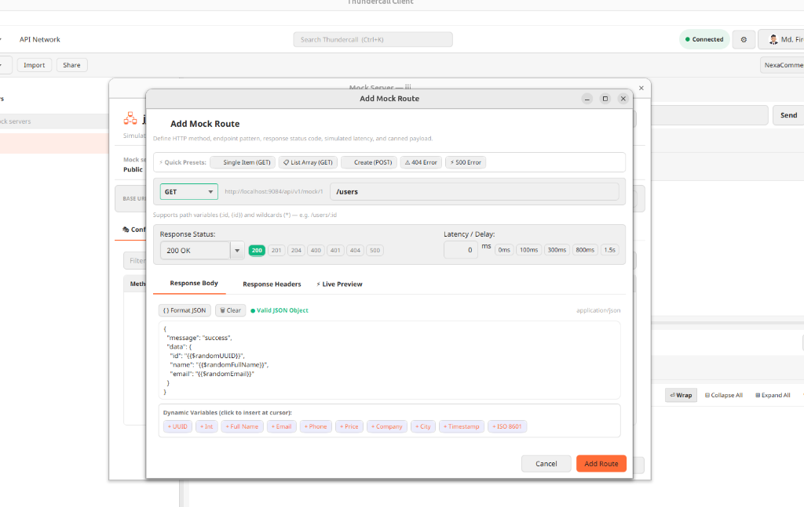
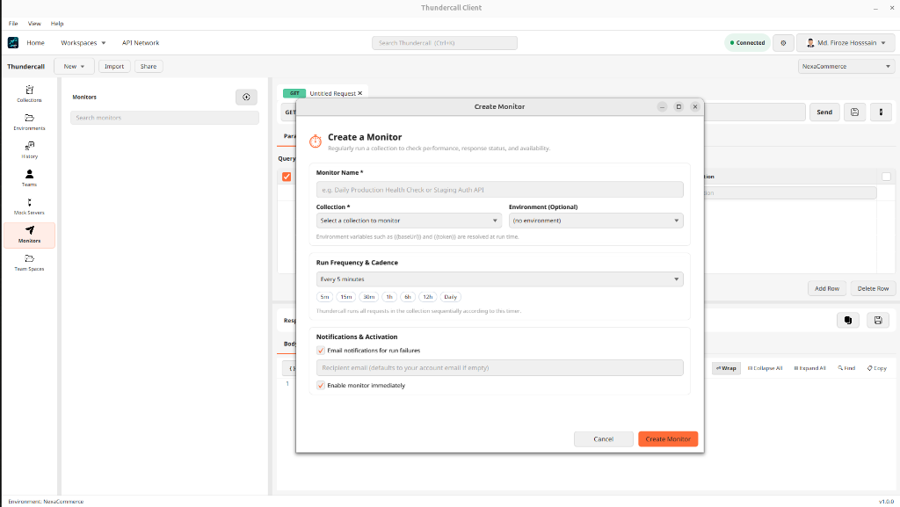
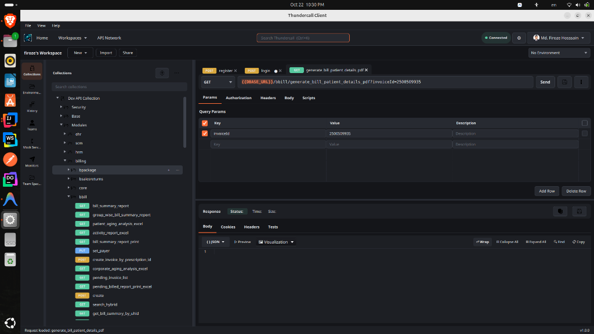
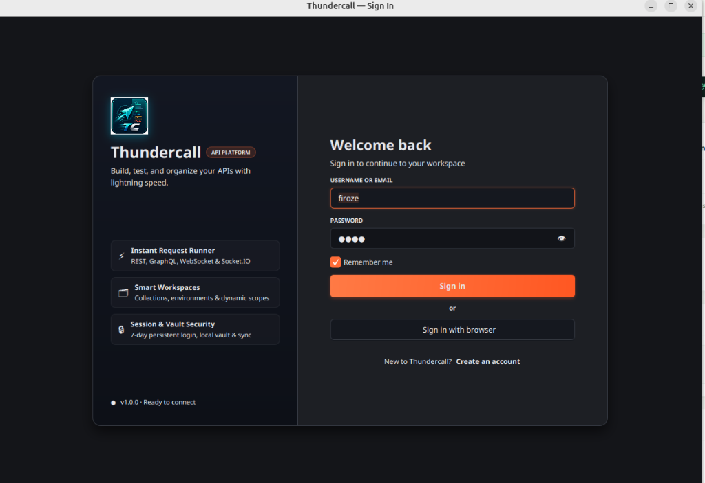
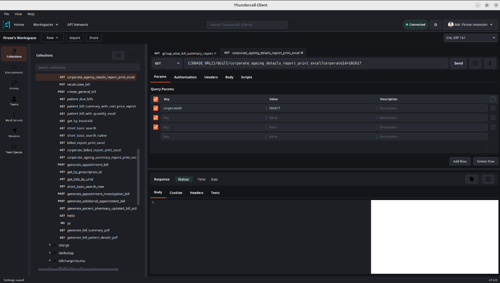

<div align="center">

# ⚡ ThunderCall

**The Free, Calm, and High-Performance API Development Platform.**  
*A lightweight native desktop client paired with a reactive backend engine — built to provide everything you need in a modern API development suite, with zero paywalls, zero seat limits, and zero cloud lock-in.*

[](https://github.com/firoze-hossain/thundercall/releases/latest)
[](https://openjdk.org/)
[](https://spring.io/projects/spring-boot)
[](https://openjfx.io/)
[](https://github.com/firoze-hossain/thundercall)
[](LICENSE)

[**Download Installers**](#-download--installation) • [**Quickstart Guide**](#-quickstart-tutorial) • [**Documentation**](http://localhost:8000/docs/thundercall) • [**Support Center**](http://localhost:8000/support/thundercall) • [**Contribute**](#-open-source-contribution)

</div>

---

## 📖 Table of Contents

- [Why ThunderCall?](#-why-thundercall)
- [Architecture & Design](#-architecture--design)
- [Visual Showcase (Light & Dark Themes)](#-visual-showcase)
- [Feature Highlights](#-feature-highlights)
- [Download & Installation](#-download--installation)
  - [Linux (Ubuntu / Debian)](#1-linux-ubuntudebian)
  - [Windows (Setup Wizard & MSI)](#2-windows-10--11)
  - [macOS (Apple Silicon & Intel)](#3-macos)
- [OS Warnings & Security Bypass Guide](#-os-installation-warnings--security-bypass)
- [Quickstart Tutorial](#-quickstart-tutorial)
- [Technology Stack](#-technology-stack)
- [Building from Source](#-building-from-source)
- [Open Source Contribution](#-open-source-contribution)
- [Support & Community](#-support--community)

---

## 💡 Why ThunderCall?

Modern API clients have become bloated, memory-hungry Electron applications that demand cloud logins, push recurring subscription paywalls, and take seconds to open. 

**ThunderCall** is engineered from the ground up to restore speed and privacy to your API development workflow:

- ⚡ **Instant Cold Startup**: Zero Electron overhead. Built with native **JavaFX** and **Spring Boot**, opening instantly with a fraction of the RAM usage.
- 🔒 **Local-First & Private**: Your collections, secrets, and environment tokens are stored locally on your machine. No forced synchronization to unvetted cloud servers.
- 🔁 **Native Collection v2.1 Compatibility**: Seamlessly import existing standard collection files, folders, environments, and test scripts with 100% schema parity.
- 👥 **Team Workspaces Without Per-Seat Fees**: Collaborate with teammates through shared workspaces, fine-grained access control (Owner, Admin, Editor, Viewer), and live presence indicators.
- 🌐 **Multi-Protocol Engine**: Test standard HTTP/REST (GET, POST, PUT, DELETE, PATCH), full-duplex WebSockets (`ws://`, `wss://`), Socket.IO events, and GraphQL with automatic schema introspection.

---

## 🏛 Architecture & Design

ThunderCall operates as an efficient dual-module architecture:

```text
+--------------------------------------------------------------------------+
|                     ThunderCall JavaFX Desktop Client                    |
|   - Multi-tabbed request builder (RichTextFX syntax highlighting)        |
|   - Real-time JSON formatting, code folding, and response search         |
|   - Dynamic {{variable}} resolution with autocomplete dropdowns          |
|   - Dark / Light ergonomic visual theme engine                           |
+------------------------------------+-------------------------------------+
                                     | High-Throughput REST IPC
+------------------------------------v-------------------------------------+
|                     ThunderCall Spring Boot Engine                       |
|   - Reactive HTTP client (Apache HttpClient 5 / WebFlux)                 |
|   - Mock server route simulator with latency injection                   |
|   - Dynamic cron-scheduled health monitors                               |
|   - JavaScript test assertion sandbox (pm.test, pm.expect)               |
|   - Local SQLite / H2 or PostgreSQL persistence                          |
+--------------------------------------------------------------------------+
```

---

## 📸 Visual Showcase

ThunderCall features a carefully crafted user interface with dedicated **Light** and **Dark** ergonomic themes designed for long development sessions.

### ☀️ Light Theme

<table>
<tr>
<td width="33%">
<a href="docs/screenshots/01-light-request-builder.png"></a>
<p align="center"><b>1. Request Builder & URL Sync</b><br/><i>Methods, query parameters, auth, and real-time response viewer.</i></p>
</td>
<td width="33%">
<a href="docs/screenshots/02-light-mock-servers.png"></a>
<p align="center"><b>2. Mock Servers</b><br/><i>Simulate endpoints, custom status codes, and latency delays.</i></p>
</td>
<td width="33%">
<a href="docs/screenshots/03-light-monitors.png"></a>
<p align="center"><b>3. API Monitors</b><br/><i>Scheduled uptime checks, execution logs, and health alerts.</i></p>
</td>
</tr>
</table>

### 🌙 Dark Theme

<table>
<tr>
<td width="33%">
<a href="docs/screenshots/04-dark-request-response.png"></a>
<p align="center"><b>4. Dual-Pane Response Viewer</b><br/><i>Full response payload inspection with JSON folding and timing metrics.</i></p>
</td>
<td width="33%">
<a href="docs/screenshots/05-dark-collections.png"></a>
<p align="center"><b>5. Hierarchical Collections</b><br/><i>Filesystem-like organization, nested resource folders, and search.</i></p>
</td>
<td width="33%">
<a href="docs/screenshots/06-dark-editor.png"></a>
<p align="center"><b>6. Advanced Code Editor</b><br/><i>RichTextFX editor with line numbers, comments, and script assertions.</i></p>
</td>
</tr>
</table>

---

## ✨ Feature Highlights

### ⚡ Request Construction & Protocols
- **HTTP Methods**: Full support for `GET`, `POST`, `PUT`, `DELETE`, `PATCH`, `HEAD`, and `OPTIONS`.
- **Bidirectional Query Parameter Sync**: Edit the URL query string directly or use the key-value table; changes sync automatically in both directions.
- **Request Body Formats**:
  - **Raw**: JSON, XML, HTML, Plain Text with line numbers, code folding, and auto-closing quotes/brackets.
  - **Multipart Form-Data**: Text fields and native file pickers for upload endpoints.
  - **x-www-form-urlencoded**: Key-value pairs for form logins and OAuth token requests.
  - **GraphQL**: Dedicated query and variables editors with real-time schema introspection.
- **WebSockets & Socket.IO**: Connect to `ws://` and `wss://` streams with message inspection, custom Socket.IO namespaces, and event emitters.

### 🗂 Collections, Environments & Variables
- **Filesystem Hierarchy**: Organize endpoints across multi-level nested folders.
- **Collection v2.1 Import & Export**: One-click import and export of standard collection and environment JSON files.
- **Dynamic Variable Resolution**: Use `{{variable}}` anywhere (URLs, headers, query params, bodies). Supports hierarchical scope resolution:
  $$\text{Local Scope} \longrightarrow \text{Environment Scope} \longrightarrow \text{Collection Scope} \longrightarrow \text{Global Scope}$$
- **Variable Autocomplete**: Type `{{` in any editor to trigger variable suggestions with live value previews.

### 🧪 Automated Testing & Script Sandbox
- **Pre-Request Scripts**: Run JavaScript before requests to generate timestamps, calculate HMAC signatures, or set nonces.
- **Test Scripts & Assertions**: Write assertions using familiar JavaScript syntax:
  ```javascript
  pm.test("Status code is 200 OK", function () {
      pm.response.to.have.status(200);
  });
  pm.test("Token returned in JSON", function () {
      var data = pm.response.json();
      pm.expect(data.token).to.be.a("string");
      pm.environment.set("authToken", data.token); // Chain to subsequent requests
  });
  ```
- **Visual Test Results**: Clean pass/fail badges with exact error trace inspection.

### 🎯 Mock Servers & API Health Monitors
- **Mock Servers**: Simulate backend responses before server code is written. Configure routes, HTTP methods, headers, status codes (200, 201, 400, 404, 500), and latency.
- **Scheduled Monitors**: Run collections automatically via cron schedules to verify production uptime and API performance.

---

## 📦 Download & Installation

Pre-built native installers for every release are available on the [**GitHub Releases Page**](https://github.com/firoze-hossain/thundercall/releases/latest).

### 1. Linux (Ubuntu/Debian)
Download the `.deb` package from the latest release:

```bash
# Install via apt (automatically resolves any system dependencies)
sudo apt install ./thundercall_1.0.0_amd64.deb

# Or install using dpkg
sudo dpkg -i thundercall_1.0.0_amd64.deb
sudo apt-get install -f
```

Launch **ThunderCall** from your application menu or run `thundercall` in your terminal.

---

### 2. Windows (10 / 11)
Download either the **Inno Setup Wizard (`.exe`)** or the **Windows Installer (`.msi`)**:

1. Run `ThunderCall-Setup-1.0.0.exe`.
2. Follow the setup wizard to create Desktop and Start Menu shortcuts.
3. Launch **ThunderCall** from your Desktop or Start Menu.

*(See [Windows SmartScreen Resolution](#windows-smartscreen-warning) below if prompted).*

---

### 3. macOS
Download the **Apple Disk Image (`.dmg`)**:

1. Open `ThunderCall-1.0.0.dmg`.
2. Drag and drop **ThunderCall.app** into your `/Applications` folder.
3. Launch **ThunderCall** from Spotlight or Launchpad.

*(See [macOS Gatekeeper Resolution](#macos-gatekeeper-unidentified-developer-warning) below for first-time launch).*

---

## 🛡️ OS Installation Warnings & Security Bypass

Because ThunderCall is an independent open-source project, our binaries are signed with automated build certificates rather than expensive corporate developer licenses (such as the paid Apple Developer Program). 

Depending on your operating system, you may see a security prompt on your first launch. **This is completely normal and safe.** Follow the steps below to run ThunderCall:

### macOS Gatekeeper ("Unidentified Developer" Warning)

When launching on macOS, you may see:
> *"ThunderCall cannot be opened because Apple cannot check it for malicious software"* or *"ThunderCall is an app downloaded from the Internet."*

#### ✅ Solution 1 (Recommended - One Click):
1. Open **Finder** and navigate to your **Applications** folder.
2. **Right-click** (or `Control` + click) on **ThunderCall.app**.
3. Click **Open** from the context menu.
4. When the confirmation prompt appears, click **Open** or **Open Anyway**. You will only need to do this once.

#### ✅ Solution 2 (Terminal Command):
Run the following command in Terminal to remove the quarantine attribute:
```bash
xattr -d com.apple.quarantine /Applications/ThunderCall.app
```

#### ✅ Solution 3 (macOS System Settings):
1. Open **System Settings > Privacy & Security**.
2. Scroll down to the **Security** section.
3. You will see: *"ThunderCall was blocked from use because it is not from an identified developer."*
4. Click **Open Anyway** and enter your administrator password.

---

### Windows SmartScreen Warning

When launching on Windows, you may see:
> *"Windows protected your PC — Microsoft Defender SmartScreen prevented an unrecognized app from starting."*

#### ✅ Solution:
1. On the SmartScreen dialog, click **More info** (under the warning text).
2. Click the **Run anyway** button that appears at the bottom right.
3. The setup wizard or application will launch immediately.

---

### Linux Security Notes

If launching on Linux distributions with strict package confinement:
- Ensure the binary has execution permissions: `chmod +x /opt/thundercall/bin/thundercall`
- If running headless or in minimal containers, ensure basic GTK libraries are installed: `sudo apt-get install -y libgtk-3-0 libgl1-mesa-glx`

---

## 🚀 Quickstart Tutorial

### 1. Launch & Select Workspace
Upon first launching ThunderCall, you'll enter your default personal workspace. You can create additional workspaces or switch to team workspaces from the top header navigation.

### 2. Send Your First Request
1. Press `Ctrl+T` (or `Cmd+T`) to open a new Request Tab.
2. Select your HTTP method (e.g. `GET`).
3. Enter `https://jsonplaceholder.typicode.com/posts/1` in the URL bar.
4. Click **Send** (or press `Ctrl+Enter`).
5. Inspect the status code (`200 OK`), round-trip latency, payload size, and formatted JSON response.

### 3. Save to a Collection
1. Press `Ctrl+S` to save the request.
2. Give it a name (e.g. `Get Post By ID`).
3. Select an existing collection or click **+ New Collection** to organize endpoints by feature or microservice.

### 4. Configure Dynamic Environments
1. Click **Environments** in the sidebar rail.
2. Create an environment named `Staging`.
3. Add a variable: `baseUrl` = `https://api.staging.example.com`.
4. In your request URL, write `{{baseUrl}}/v1/users`. ThunderCall will automatically substitute the value on send.

### 5. Clear Cache & Diagnostics
If you ever need to purge local caches and re-sync everything from the backend:
- Navigate to **Help > Clear Cache and Reload**.
- ThunderCall flushes all temporary buffers, reloads collections and environments, and refreshes the application state cleanly.

---

## 🛠️ Technology Stack

ThunderCall is built on a modern, decoupled Java architecture:

### Frontend Subsystem (`thundercall-frontend`)
| Component | Technology | Description |
|---|---|---|
| **Runtime & UI** | Java 25 LTS, JavaFX | Native high-performance cross-platform GUI |
| **Code Editor** | RichTextFX, ReactFX | Real-time syntax highlighting, code folding, auto-indent |
| **JSON Parser** | Jackson Databind & JSR-310 | High-throughput JSON serialization & date formatting |
| **Vector Icons** | Ikonli (FontAwesome 5) | Crisp resolution-independent icons across DPI scales |
| **PDF Rendering** | Apache PDFBox | Native preview of binary PDF responses |
| **Build & Package** | Maven, `jpackage` | Generates native `.deb`, `.exe`, `.msi`, `.dmg` installers |

### Backend Subsystem (`thundercall-backend`)
| Component | Technology | Description |
|---|---|---|
| **Framework** | Spring Boot 3.3.x / WebFlux | Reactive, non-blocking service engine |
| **Security** | Spring Security 6, JWT | Granular workspace role-based authorization |
| **HTTP Engine** | Apache HttpClient 5 | Multi-protocol execution engine (HTTP/1.1, HTTP/2) |
| **Real-time** | `socket.io-client` | Full-duplex WebSocket and Socket.IO multiplexing |
| **Persistence** | Spring Data JPA / Hibernate | SQLite, H2, or PostgreSQL database compatibility |
| **Task Scheduler** | ThreadPoolTaskScheduler | Reliable background execution of cron monitors |

---

## 🏗️ Building from Source

To compile and run ThunderCall locally on your machine:

### Prerequisites
- **JDK 25 LTS** or later ([Temurin](https://adoptium.net/) or [Oracle OpenJDK](https://jdk.java.net/25/))
- **Maven 3.9+**
- Git

### 1. Clone the Repository
```bash
git clone https://github.com/firoze-hossain/thundercall.git
cd thundercall
```

### 2. Start the Backend Engine
```bash
cd thundercall-backend
mvn clean spring-boot:run
```
*The backend API initializes on `http://localhost:9084/api/v1`.*

### 3. Launch the Desktop Client
In a new terminal:
```bash
cd thundercall-frontend
mvn clean javafx:run
```

---

## 🤝 Open Source Contribution

We welcome contributions from developers worldwide! Whether fixing bugs, adding new protocol adapters, improving documentation, or refining UI components:

### How to Contribute
1. **Fork the Repository**: Click **Fork** at the top right of this page.
2. **Create a Feature Branch**:
   ```bash
   git checkout -b feature/awesome-new-protocol
   ```
3. **Commit Your Changes**: Follow clear commit message standards:
   ```bash
   git commit -m "feat(protocols): add MQTT client testing tab"
   ```
4. **Run Verification Builds**:
   ```bash
   mvn clean compile -DskipTests
   ```
5. **Open a Pull Request**: Submit your pull request to the `master` branch with a clear summary of changes and screenshots.

### Contribution Guidelines
- Preserve UI consistency with ThunderCall's design system (rounded corners, subtle borders, ergonomic dark/light palettes).
- Keep authorization logic routed through `WorkspaceAccessGuard` to preserve team permissions.
- Test backwards compatibility with the Collection v2.1 schema.

---

## 💬 Support & Community

- **Support Center**: Browse project-specific solutions and FAQs at [**ThunderCall Support**](http://localhost:8000/support/thundercall).
- **Documentation**: Full setup and architecture manuals at [**ThunderCall Docs**](http://localhost:8000/docs/thundercall).
- **Bug Reports & Feature Requests**: Submit an issue on the [**GitHub Issues Tracker**](https://github.com/firoze-hossain/thundercall/issues).
- **Author & Maintainer**: [**Md. Firoze Hossain**](https://github.com/firoze-hossain) &bull; Part of the **RozeHub Developer Ecosystem**.

---

<div align="center">
<b>ThunderCall is free and open source software licensed under the MIT License.</b><br/>
<sub>Crafted with passion for calm, productive API development.</sub>
</div>
